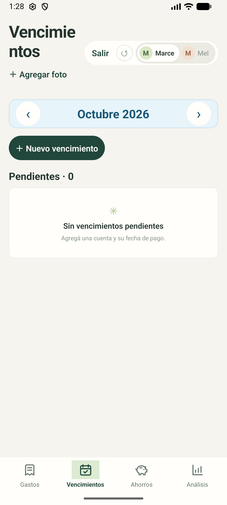

# Duo

Duo is an Android app for managing personal and shared finances in one place. Its interface is in Spanish.

Duo makes it possible to record an expense once and choose whether to share it, avoiding duplicate entries while keeping personal and shared finances connected.

## Screenshots

  

  

## Features

- Create an account with Google and link a two-person shared account using a single-use invitation code.
- Record personal and shared expenses, income, transfers and debts.
- Follow due dates, savings and financial summaries in Argentine pesos and US dollars.

Personal records are private to their owner. Shared expenses, savings and receipts are accessible only to the two members of the linked account; different couples remain isolated.

## Technology

React Native, Expo, TypeScript, AsyncStorage and Supabase.

## Project Structure

```text
duo-android/
├── App.tsx          # Main app interface
├── src/             # Components, finance logic and data services
├── assets/          # App images and other assets
├── screenshots/     # App screenshots
├── scripts/         # Local checks
├── supabase/        # Database migrations, functions and tests
└── package.json     # Dependencies and scripts
```

## Development setup

1. Install dependencies with `npm ci` and copy `.env.example` to `.env`. Use your own Supabase project URL and publishable key. Keep secrets and `google-services.json` outside Git.
2. Apply the SQL files in `supabase/migrations/` in chronological order to your own Supabase project. The [public Google registration migration](supabase/migrations/20261126000100_duo_public_google_registration.sql) removes the initial per-email signup allowlist while continuing to reject other signup providers and anonymous registrations.
3. Enable Google and **Allow new users to sign up** in Supabase Authentication. Configure the **Before User Created** hook to call `public.duo_before_user_created`.
4. Configure Google OAuth with only the basic identity scopes: `openid`, `userinfo.email` and `userinfo.profile`. The Google client's redirect URI is the callback shown by Supabase. Add `com.duo.publicdemo://auth/callback` to Supabase's allowed redirect URLs for the public demo configuration in this repository.
5. Start development with `npm start`. Each person creates their own profile; one generates an invitation code and the other accepts it. Invitations expire after 24 hours and can be used once.

Applying changes to GitHub does not configure a Supabase project automatically. Existing installations retain their users and records when the signup migration is applied.

## Checks

```sh
npm run typecheck
npm run test:receipts
```

The database checks run against isolated PGlite data and include [Google signup authorization](supabase/tests/duo_public_google_registration.sql) and [privacy across two independent couples](supabase/tests/duo_multiple_couples_privacy.sql), covering personal records, shared balances, due dates, interest settings, receipt storage, invitation reuse and notification recipients.
