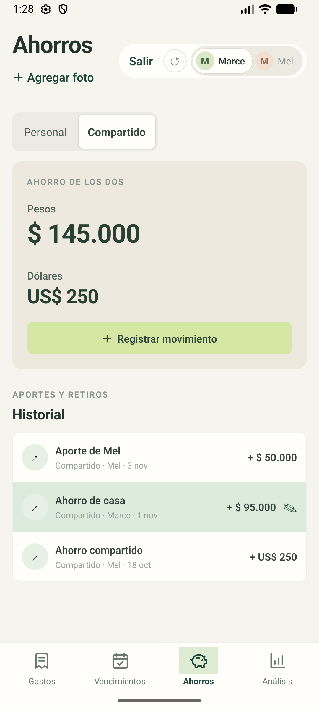

# Duo

Duo is a personal finance app for tracking individual and shared finances. This repository contains the Android app source and screenshots of its built-in demo, populated with example data. The interface is in Spanish.

## Screenshots

  

  

## Features

- Record personal and shared expenses, income, transfers and debts.
- Follow due dates, savings and financial summaries in Argentine pesos and US dollars.
- Explore the app using sample data stored locally on the device, with a control to reset the demo.
- Optional Supabase integration for authenticated data and additional cloud features when configured separately.

## Technology

React Native, Expo, TypeScript, AsyncStorage and Supabase.

## Run locally

Install Node.js and the dependencies, then start Expo:

```bash
npm ci
npm start
```

Open the app with a compatible Android development environment and select **Abrir demo**. Without Supabase environment variables, the demo works locally and does not connect to the original database. Cloud features require your own Supabase project, configuration and deployment; see `.env.example` and the `supabase` directory. Never commit credentials.

This public copy excludes the original project's private configuration and disables its Expo updates. The demo data is illustrative; it is not a production account. A standalone Android APK download is not yet available.

