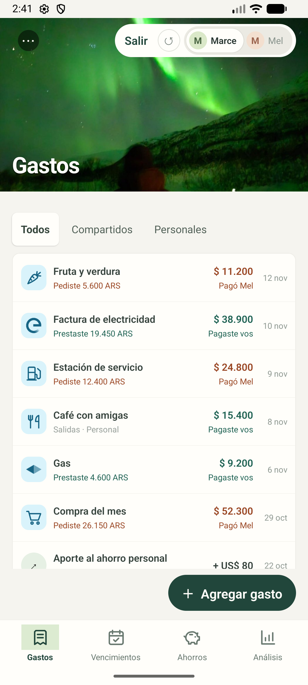
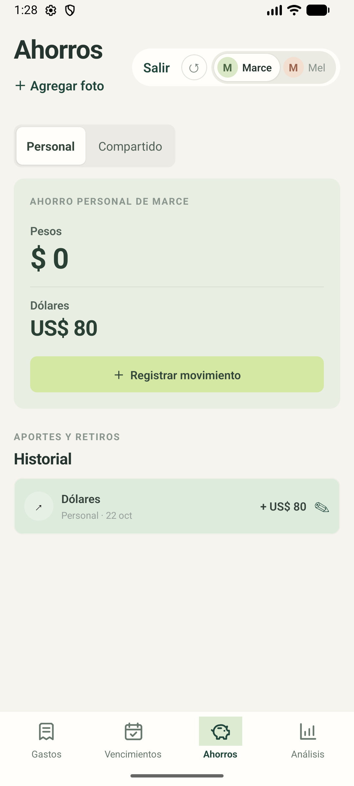

# Duo

Duo is an Android app for managing personal and shared finances in one place. Its interface is in Spanish.

I created Duo because I wanted to keep track of my personal finances while also sharing expenses with my partner, Mel. I didn't want to enter a shared expense like a supermarket trip twice: once in my personal records and again in our shared account. With Duo, I can record it once and choose to share it, keeping both views connected.

## Screenshots

  

  

## Features

- Record personal and shared expenses, income, transfers and debts.
- Follow due dates, savings and financial summaries in Argentine pesos and US dollars.

## Technology

React Native, Expo, TypeScript, AsyncStorage and Supabase.

## Project Structure

```text
duo-android/
├── App.tsx          # Main app interface
├── src/             # Components, finance logic and data services
├── assets/          # App images and other assets
├── screenshots/     # App screenshots
├── scripts/         # Local checks
├── supabase/        # Database migrations, functions and tests
└── package.json     # Dependencies and scripts
```
