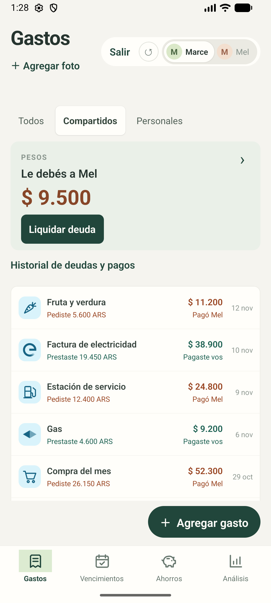

# Duo

Duo is an Android app for managing personal and shared finances in one place. Its interface is in Spanish.

Duo makes it possible to record an expense once and choose whether to share it, avoiding duplicate entries while keeping personal and shared finances connected.

[Download APK for Android](https://github.com/adrianmarceloledesma/duo-android/releases/download/v0.1.9/duov1.8.apk)

## Screenshots

  

  

## Features

- Create an account with Google and link a two-person shared account using a single-use invitation code.
- Record personal and shared expenses, income, transfers and debts.
- Follow due dates, savings and financial summaries in Argentine pesos and US dollars.

Personal records are private to their owner. Shared expenses, savings and receipts are accessible only to the two members of the linked account; different couples remain isolated.

## Technology

React Native, Expo, TypeScript, AsyncStorage and Supabase.

## Project Structure

```text
duo-android/
├── App.tsx          # Main app interface
├── src/             # Components, finance logic and data services
├── assets/          # App images and other assets
├── screenshots/     # App screenshots
├── scripts/         # Local checks
├── supabase/        # Database migrations, functions and tests
└── package.json     # Dependencies and scripts
```

## Checks

```sh
npm run typecheck
npm run test:receipts
```

The database checks run against isolated PGlite data and include [Google signup authorization](supabase/tests/duo_public_google_registration.sql) and [privacy across two independent couples](supabase/tests/duo_multiple_couples_privacy.sql), covering personal records, shared balances, due dates, interest settings, receipt storage, invitation reuse and notification recipients.
